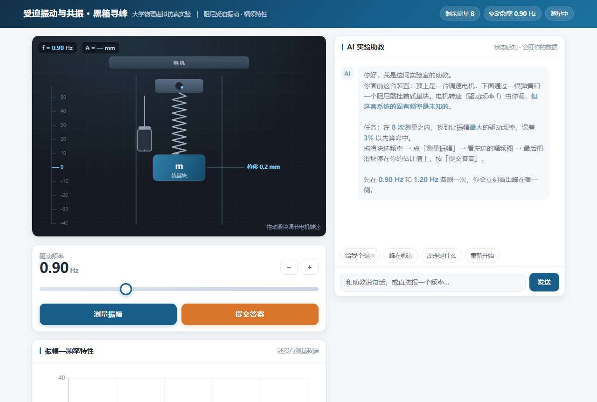
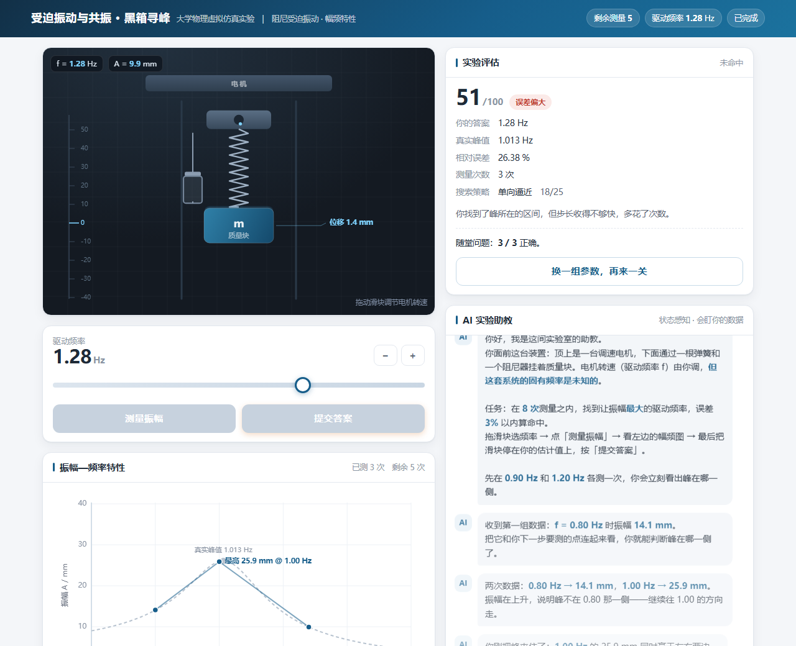

# 受迫振动与共振 · 黑箱寻峰

> 一个会「盯过程」的 AI 实验助教 —— 大学物理虚拟仿真实验

**在线体验**：<https://你的用户名.github.io/仓库名/> （部署后替换这一行）

单文件 46 KB · 零第三方依赖 · 断网可用 · 手机浏览器可用



---

## 这是什么

一台调速电机通过弹簧和阻尼器悬挂着质量块，电机底座做简谐位移，带动质量块做受迫振动。

但系统的**固有频率、阻尼比、弹簧刚度全部是隐藏的**——你只能看到一个数字：

> 我调到 f Hz 时，振幅是 A mm。

任务：在 **8 次测量**内，找到让振幅最大的驱动频率。

这不是「背公式」的题，而是「设计搜索策略」的题：先粗扫定位、再二分收缩、最后收敛。



---

## 为什么它不只是个动画

市面上大多数虚拟仿真，要么「能看不能做」（点一下播个动画就结束），要么「能测不能评」（学生乱试八次碰对了照样满分）。

这个实验的评分刻意**向过程倾斜**：

| 维度 | 分值 | 怎么判 |
|---|---|---|
| 准确度 | 50 | 相对误差 ≤1% / ≤2% / ≤3% / ≤5% / >5% |
| 效率 | 25 | 用了几次测量 |
| 策略 | 25 | 区间收缩法 / 单向逼近 / 粗略扫点 / 随机试探 |

「策略」这一项，看的不是你最后报的数字对不对，而是**你怎么找的**：测量序列的步长有没有递减，峰有没有被真正夹在两个点之间。

---

## AI 是怎么融进来的

**它不是聊天机器人**，而是四个只服务于实验流程的能力：

| 能力 | 你看到的样子 | 背后做了什么 |
|---|---|---|
| 状态感知对话 | 「两次数据：0.80 Hz → 15.8 mm，1.00 Hz → 31.9 mm。振幅在上升，说明峰不在 0.80 那一侧——继续往 1.00 的方向走。」 | 读取真实测量记录，比较两点幅值，判断单峰方向 |
| 轻量意图解析 | 直接打「1.05」就设为频率；说「峰在哪边」「原理是什么」「重新开始」走不同分支 | 规则 + 正则的极简 NLU |
| 过程性评估 | 「你找到了峰所在的区间，但步长收得不够快，多花了次数。」 | 分析步长趋势与夹逼情况，输出策略标签 |
| 自适应脚手架 | 第一次测完只给方向；夹住峰后报区间与剩余次数；只剩两次时催提交 | 按实验阶段推进的提示分级 |

### 为什么不用大模型

这是这个项目里最花时间的一个决定。算笔账：

| 方案 | 体积 | 加载 | 结论 |
|---|---|---|---|
| Qwen2.5-0.5B 量化 | ≈ 400 MB | 数十秒 | 直接突破「加载 < 3 秒」 |
| 更小的 0.3B 级 | ≈ 250 MB | 仍然过慢 | 中文表达质量明显下降 |
| WebLLM / WebGPU | 首次数百 MB 下载 | 不可控 | 依赖显卡，违反「免安装」 |
| **内置规则引擎** | **0 KB 额外** | **< 100 ms** | **零延迟、可预测、离线** |

结论：把「AI 能力」落在**能不能读懂实验状态**上，而不是**能不能说漂亮话**上。每一条判断都由物理量和测量序列算出来，结果可复现、可解释。

代码里也留了可插拔的 `reply()` 层——将来允许联网了，换掉这一层就行，物理引擎和评估算法一行不用动。

---

## 技术要点

**物理模型**：电机底座简谐位移 `y_s = Y·sin(ωt)`，弹簧与阻尼并联下传，运动方程

```
m·ü + c·u̇ + k·u = k·y_s + c·ẏ_s
```

稳态振幅

```
A(ω) = Y·√(k² + (cω)²) / √((k − mω²)² + (cω)²)
```

**测量**用四阶龙格-库塔真实积分，步长 1/1600 s，先积分 `max(7, 5/f)` 秒到稳态，再取后 `max(2/f, 1.2)` 秒的位移峰值，最后叠加 ±0.2% 的确定性重复性噪声——所以同一频率重复测，数字会有极微小的差别，像真的仪器。

**校验结果**（`phys_check.js`，node 跑）：

- 解析解 vs 数值积分，9 个频点最大偏差 **0.62%**
- 峰位：解析 1.038 Hz vs 数值扫描 1.040 Hz，差 **0.002 Hz**
- 30 组随机参数，峰位 0.920–1.108 Hz、峰值 23.1–33.6 mm，**异常 0 组**

**为什么是单文件**：原生 Canvas 2D + 无框架 + 一个 IIFE，46 KB、1145 行、零外部请求。双击就能开，断网也能用。

---

## 本地运行

不用装任何东西：

```bash
# 方式一：双击
index.html

# 方式二：起个本地服务（想在手机上测就用这个）
python -m http.server 8000
# 然后手机连同一个 WiFi，访问 http://电脑IP:8000
```

---

## 目录

```
index.html            单文件 H5 源码（含全部 CSS / JS / 物理引擎 / AI 助教）
screenshots/          界面截图
docs/方案文档.docx     完整方案文档（选题背景、技术路线、AI 思路、用户手册、学术诚信声明）
LICENSE               MIT
```

---

## 随堂三题（自测）

1. 阻尼比从 0.09 增大到 0.14，共振峰怎么变？→ **峰值降低、峰变宽**（峰值 ≈ Y/(2ζ)，Q = 1/(2ζ)）
2. 共振时驱动力与速度的相位关系？→ **同相**，速度达最大，每周期输入能量最多
3. 把装置搬到月球（重力 1/6），共振频率怎么变？→ **不变**（f₀ = (1/2π)√(k/m)，与 g 无关）

---

## 作者

张梓强 · 计算机科学与技术 2 班 · 202500202051

## License

[MIT](LICENSE)
